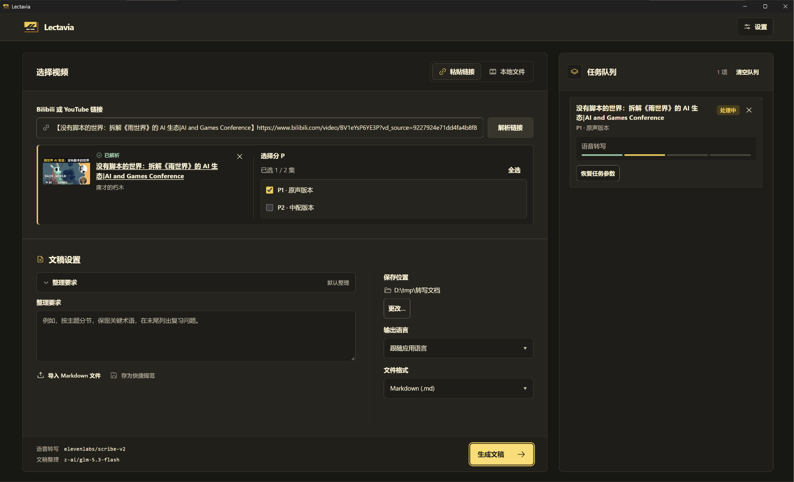

<div align="center">
  

  <h1>Lectavia</h1>

  <p><a href="README.md">English</a> · <strong>简体中文</strong> · <a href="README-jp.md">日本語</a></p>

  <p><strong>把长视频变成真正能读、能留存的本地文稿</strong></p>

  <p>
    粘贴 Bilibili、YouTube 链接或拖入本地视频，自动完成音轨提取、语音转写与大模型深度整编，<br />
    直接输出结构清晰、错词已修的本地 <code>.md</code> 或 <code>.txt</code> 学习资料。
  </p>

  <p>
    
    
    
    
  </p>
</div>

<br />

<div align="center">
  
</div>

---

## 为什么做 Lectavia？

视频是极佳的信息载体，但不是高效的阅读与检索媒介。一小时的公开课、技术分享或深度访谈，如果靠倍速播放加手敲笔记，往往耗时费力；而普通语音转写工具吐出的“纯逐字稿”，充斥着口语赘词、断句混乱与同音错字，几乎无法直接阅读。

**Lectavia 将“听视频”彻底简化为“读文稿”：**

1. **提取与切片**：自动拉取在线音轨或剥离本地视频音频，按长音频切片策略稳定送入语音识别（ASR）。
2. **语境感知整编**：将视频标题、分 P 标题、简介与完整转写稿一同交给大语言模型（LLM），结合上下文自动修正专业术语与识别错字、理顺口语逻辑，并按你的要求排版成文。
3. **落盘即用**：直接生成干净的本地 `.md` 或 `.txt` 文件，不绑架数据，无需在臃肿的专有笔记软件里二次导出。

---

## 核心特性

### 🎬 在线与本地通吃，原生支持 Bilibili 分 P 批处理

- **多源合一**：支持 Bilibili（含 `b23.tv` 短链）、YouTube 链接以及本地视频（`MP4`、`MKV`、`WebM`、`MOV`、`M4V`、`AVI`）。
- **分 P 自由勾选**：粘贴链接失焦即刻解析标题与分集列表。面对几十集的 Bilibili 课程，可按需勾选任意分 P 批量入队，生成后自动按视频标题归档至独立文件夹。

### ✍️ 由你定义文稿长什么样

- **默认精修，拒绝机翻感**：内置高保真整理提示词，在忠实保留讲者原意与关键细节的前提下，自动消除口语残句与识别噪音，绝不掺杂“待核对”等干扰标记。
- **自定义要求与快捷规范**：想要“按主题分节并提炼核心术语”，还是“整理为课堂讲义并在末尾附带复习题”？直接输入要求或导入外部 `.md` 规范，还可将常用指令存为**快捷规范（Presets）**一键复用。
- **跨语言输出**：支持将任意语言视频直接整编为简体中文、繁体中文、英语、日语、韩语、法语、德语等 **15 种语言**的文稿。

### 🔑 自带模型（BYOK），零环境折腾

- **安装包开箱即用**：Windows x64、Linux x64 与 Apple Silicon（macOS 26+）安装包已内置 `yt-dlp`、`FFmpeg`、`FFprobe`、`Python` 与 `QuickJS-NG`。装好就能解析在线视频，无需手动配置环境变量或安装命令行依赖。
- **转写与整理独立配置**：接入任何兼容 OpenAI 接口的服务商（OpenRouter、OpenAI、DeepSeek、硅基流动或本地网关）。语音转写（`/audio/transcriptions`）与文稿整理（`/chat/completions`）分开设置，支持一键拉取模型列表与调节推理模型的**思考强度（Reasoning Effort）**。
- **本地优先与隐私安全**：API Key 存储在操作系统原生凭据库中；无账号体系，无云端同步，生成的每一份文稿都直接写进你指定的本地目录。

### 🤖 一个内核，三种形态：Desktop · MCP · CLI

Lectavia 不只是一个桌面窗口。它的底层任务队列与并发调度引擎同时向 **AI Agent（MCP）** 和 **终端脚本（CLI）** 开放：

- **桌面工作台**：直观管理并发任务队列，支持单集取消、失败重试、一键在文件管理器中定位文稿。
- **内置 MCP 服务**：在设置中一键开启 `HTTP` 或 `stdio` 接入，让 Claude Desktop、Claude Code、Cursor 等 Agent 直接替你“看视频、读逐字稿、写总结”。
- **独立命令行 `lectavia-cli`**：无需打开桌面窗口，直接复用已保存的模型凭据，在脚本中批量将视频转为文档。

---

## 三步上手

1. **配置模型**。在「模型设置」中选择 ElevenLabs、Groq、OpenAI 或 OpenRouter，填写 API Key，再从实时列表中选择转写模型。自建或代理服务请选择「自定义 OpenAI 兼容接口」并填写完整转写地址。文稿整理需要填写完整 API 地址、API Key 和模型 ID。自定义转写和文稿整理均可另填模型列表地址。
2. **载入视频**：粘贴 Bilibili / YouTube 链接（自动解析标题与分 P），或直接选择本地视频文件。
3. **生成文稿**：选择本地保存目录与输出格式（`.md` / `.txt`），按需选择快捷规范或补充整理要求，点击 **「生成文稿」** 即可在右侧队列实时查看进度并直达文件。

> **提示**：处理超长视频若遇到服务商单次音频 25 MB 限制，可在「设置 → 转写音频切片时长」中将切片时长从默认的 `1200` 秒（20 分钟）调小后重试。

---

## 接入 AI Agent（MCP 服务）

打开 Lectavia「设置 → MCP 服务」，启用 **HTTP**（可设为随应用自启）或 **stdio**，点击「复制配置」即可粘贴到你的 Agent 客户端。桌面端与 MCP 提交的任务共享同一个任务列表与最大并发设置。

MCP 服务向 Agent 暴露以下 4 个工具：

| 工具名称            | 用途说明                                                                                                                                                                                 |
| :------------------ | :--------------------------------------------------------------------------------------------------------------------------------------------------------------------------------------- |
| `inspect_video`     | 解析本地或在线视频元数据，获取标题与 Bilibili 分 P 列表。                                                                                                                                |
| `generate_document` | 提交异步生成任务（返回 `job_id`）。支持传入 `video`（可选指定分 P）或已有 `transcript_paths`；可切换 `mode: "document"`（LLM 精修文稿）与 `mode: "transcript"`（仅输出语音转写逐字稿）。 |
| `get_job`           | 查询任务整体状态、各分 P 阶段进度、错误信息以及已生成文稿的本地绝对路径 `output_path`。                                                                                                  |
| `cancel_job`        | 取消整个任务或指定的 `part_ids`，已完成的文件会安全保留。                                                                                                                                |

---

## 命令行使用（`lectavia-cli`）

在桌面端保存好模型设置后，同一系统账户下即可直接调用 `lectavia-cli`（运行时无需保持桌面端开启）。

- **Windows**：位于 Lectavia 安装目录（`lectavia-cli.exe`）
- **macOS**：`/Applications/Lectavia.app/Contents/MacOS/lectavia-cli`
- **Linux (`.deb`)**：`/usr/bin/lectavia-cli`

### 常用示例

```powershell
# 转写本地视频，附带自定义整理要求并输出到指定目录
lectavia-cli "./lesson.mp4" -o "D:/Notes" --instructions "按主题分节，保留关键术语，末尾列出复习问题。"

# 仅挑取 Bilibili 多 P 视频的第 1、3 集，输出为纯文本
lectavia-cli "https://www.bilibili.com/video/BV1xx411c7mD" --parts "1,3" --format txt

# 转写 YouTube 视频，从外部 Markdown 读取整理规范并指定英文输出
lectavia-cli "https://www.youtube.com/watch?v=dQw4w9WgXcQ" --instructions-file "./prompt.md" --lang en
```

### 参数速查

语法：`lectavia-cli [选项] <视频路径或链接>`

| 参数                         | 说明                                                                                        |
| :--------------------------- | :------------------------------------------------------------------------------------------ |
| `<视频>`                     | 必填。本地视频路径，或 Bilibili（支持短链）、YouTube 的 HTTPS 链接。                        |
| `-o, --output-dir <目录>`    | 输出目录（需已存在且可写），默认为当前工作目录。多 P 视频会自动创建同名子目录。             |
| `--format <md\|txt>`         | 输出格式：`md`（默认）或 `txt`。                                                            |
| `--parts <编号>`             | 仅用于 Bilibili。逗号分隔的分 P 编号（如 `"1,3"`）；省略时读取链接中的 `?p=` 或默认第 1 P。 |
| `--instructions <文本>`      | 附加的自定义整理要求。                                                                      |
| `--instructions-file <文件>` | 从 UTF-8 文件读取自定义整理要求（与 `--instructions` 互斥）。                               |
| `--lang <zh-CN\|ja\|en>`     | 内置提示词、文件标签与终端进度使用的语言，默认 `zh-CN`。                                    |

> **脚本集成友好**：CLI 会将生成成功的文稿路径**逐行输出到 `stdout`**，而将进度与错误输出到 `stderr`（退出码：`0` 全部成功，`1` 运行或部分分 P 失败，`2` 参数错误），方便在 Shell / PowerShell 管道中直接捕获生成结果。

---

## 本地开发与构建

<details>
<summary>展开查看开发环境配置与打包指南</summary>

### 环境要求

- Node.js 24、pnpm、Rust stable，以及 [Tauri 2 系统依赖](https://v2.tauri.app/start/prerequisites/)（Windows 需 Visual Studio C++ 桌面开发工具与 WebView2）。
- 本地开发时需准备 `FFmpeg`、`yt-dlp`，解析 YouTube 另需 `Deno` 或 `Node.js 22+`（可通过 `PATH` 或 `LECTAVIA_MEDIA_DIR` 指定，Windows 下也可直接运行下方初始化脚本自动安装）。

### 启动开发环境

```powershell
pnpm install

# Windows 可选：使用 WinGet 自动补齐本地开发所需的媒体工具
powershell -ExecutionPolicy Bypass -File scripts/setup-media.ps1

# 启动桌面端热重载开发模式
pnpm tauri dev
```

### 常用检查与打包命令

```bash
# 代码格式检查与修复
pnpm format:check
pnpm format

# 前端类型检查与构建 / Rust 后端测试
pnpm build
cargo test --manifest-path src-tauri/Cargo.toml --locked

# 仅编译独立 CLI 二进制文件
cargo build --manifest-path src-tauri/Cargo.toml --release --locked --no-default-features --bin lectavia-cli

# 构建自带全套媒体工具的平台安装包
npm run app:build:setup                     # Windows x64 (NSIS)
pnpm tauri build --bundles deb,appimage     # Linux x64
pnpm tauri build --bundles dmg              # Apple Silicon macOS (macOS 26+)
```

打包流程会自动下载并校验预编译的 LGPL 版 `FFmpeg` / `FFprobe`、`Python`、`yt-dlp` 与 `QuickJS-NG`（版本与校验值维护在 `scripts/prepare-ffmpeg.js` 及 `scripts/prepare-online-media.*` 中）。

</details>

---

## 许可证

本项目基于 [MIT License](LICENSE) 开源。安装包内随附的第三方媒体组件许可声明位于应用目录下的 `media-tools/ffmpeg/dist`。
