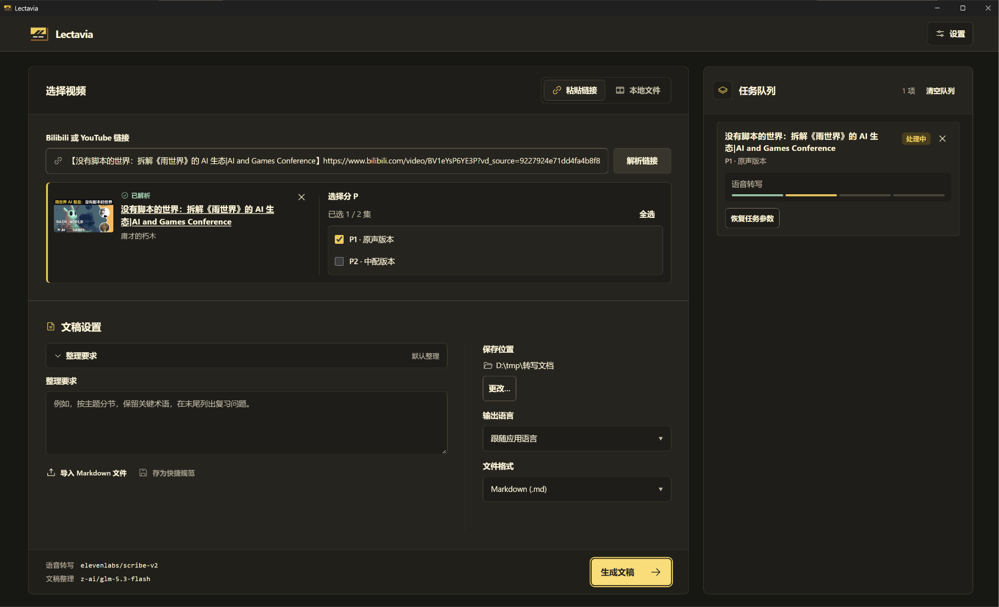

<div align="center">
  

  <h1>Lectavia</h1>

  <p><a href="README.md">English</a> · <a href="README-cn.md">简体中文</a> · <strong>日本語</strong></p>

  <p><strong>長い動画を、読み返せる原稿に</strong></p>

  <p>
    Bilibili や YouTube のリンクを貼り付けるか、ローカルの動画をドラッグ＆ドロップします。<br />
    音声の抽出と文字起こしを行い、大規模言語モデルで認識誤りを修正し、読みやすく整理した学習資料を <code>.md</code> または <code>.txt</code> としてローカルに保存します。
  </p>

  <p>
    
    
    
    
  </p>
</div>

<br />

<div align="center">
  
</div>

---

## Lectavia を作った理由

動画は情報を伝えるのに適していますが、内容をざっと読んだり、あとで特定の箇所を探したりするのには時間がかかります。1 時間の公開講座や技術講演、インタビューを倍速で再生しても、手作業でメモを取るには手間がかかります。文字起こしをそのまま読むにも、言いよどみや不自然な文の区切り、同音異義語の誤認識が妨げになります。

Lectavia は、次の 3 段階で動画を読み返せる原稿にします。

1. **音声を抽出して分割する。** オンライン動画から音声を取得するか、ローカル動画から音声を抽出し、自動音声認識（ASR）に送るためのチャンクに分割します。
2. **動画の文脈をもとに原稿を整理する。** 文字起こしの全文に加え、動画タイトル、パートごとのタイトル、概要欄を大規模言語モデル（LLM）に渡します。モデルは文脈をもとに専門用語や認識誤りを修正し、話の流れを整え、指定された形式で原稿を作成します。
3. **原稿をローカルに保存する。** `.md` または `.txt` ファイルとして保存します。普段使っているエディターでそのまま開けます。

---

## 主な機能

### 🎬 オンライン動画とローカル動画に対応し、Bilibili のパートを一括処理

- **対応する動画ソース。** Bilibili（`b23.tv` の短縮リンクを含む）、YouTube、ローカル動画（`MP4`、`MKV`、`WebM`、`MOV`、`M4V`、`AVI`）に対応します。
- **処理するパートを選択。** Bilibili のリンクを貼り付けて入力欄からフォーカスを外すと、動画タイトルとパート一覧が表示されます。必要なパートをまとめてキューに追加でき、生成された原稿は動画タイトルと同じ名前のフォルダーに保存されます。

### ✍️ 用途に合わせて原稿を整理

- **組み込みの整理指示。** 話者の意図と重要な情報を保ちながら、言いさしや認識誤りを修正します。組み込みの指示により、「要確認」などの編集用の印が原稿に入らないようにします。
- **独自の指示とプリセット。** 「話題ごとに節を分けて重要な用語を抜き出す」「講義資料として整理し、末尾に復習問題を付ける」といった指示を入力できます。`.md` ファイルから指示を読み込んだり、よく使う指示を**整理指示のプリセット**に保存したりすることもできます。
- **15 言語で出力。** 動画の言語にかかわらず、簡体字中国語、繁体字中国語、英語、日本語、韓国語、フランス語、ドイツ語など、対応する 15 言語で原稿を作成できます。

### 🔑 自分の API キーを利用（BYOK）

- **メディアツールを同梱。** Windows x64、Linux x64、Apple Silicon（macOS 26 以降）向けインストーラーには、`yt-dlp`、`FFmpeg`、`FFprobe`、`Python`、`QuickJS-NG` が含まれます。環境変数の手動設定やコマンドラインツールの追加インストールなしで、オンライン動画を処理できます。
- **文字起こしと原稿整理のモデルを個別に設定。** OpenRouter、OpenAI、DeepSeek、SiliconFlow、ローカルゲートウェイなど、OpenAI 互換 API を提供するサービスを利用できます。文字起こし（`/audio/transcriptions`）と原稿整理（`/chat/completions`）を個別に設定でき、モデル一覧の取得や、推論モデルの推論強度（Reasoning Effort）の調整にも対応します。
- **ローカルに保存。** API キーは OS の資格情報ストアに、原稿は指定したローカルフォルダーに保存します。Lectavia のアカウント登録やクラウド同期はありません。

### 🤖 デスクトップ、MCP、CLI で使える共通のタスクエンジン

- **デスクトップ画面。** タスクキューを管理し、パート単位のキャンセル、失敗したタスクの再試行、ファイルマネージャーでの保存先の表示ができます。
- **組み込みの MCP サービス。** 設定で HTTP または stdio を有効にすると、Claude Desktop、Claude Code、Cursor などの AI エージェントから動画情報を取得し、文字起こしや要約を作成できます。
- **単体で動く `lectavia-cli`。** 保存済みのモデル設定を使い、デスクトップ画面を開かずにスクリプトから動画を一括で原稿に変換できます。

---

## 使い方

1. **モデルを設定する。** **モデル設定**で ElevenLabs、Groq、OpenAI、OpenRouter のいずれかを選び、API キーを入力して、取得した一覧から文字起こしモデルを選びます。独自の URL を使う場合は**カスタムの OpenAI 互換 API**を選びます。原稿整理には API の完全な URL、API キー、モデル ID を入力します。カスタムの文字起こしと原稿整理では、モデル一覧 URL も任意で指定できます。
2. **動画を読み込む。** Bilibili や YouTube のリンクを貼り付けると、動画タイトルと、パートがある場合はその一覧が表示されます。ローカルの動画ファイルも選択できます。
3. **原稿を作成する。** 保存先のフォルダーと出力形式（`.md` または `.txt`）を選びます。必要に応じてプリセットを適用するか、整理指示を追加します。**原稿を作成**をクリックすると、画面右側のキューで進捗を確認し、生成されたファイルを開けます。

> **ヒント**　長い動画の処理で音声チャンクが 25 MB の上限を超える場合は、**設定 → 文字起こし用の音声チャンクの長さ**で既定値の 1200 秒（20 分）より短く設定して再試行します。

---

## MCP で AI エージェントに接続する

Lectavia の**設定 → MCP サービス**を開き、**HTTP** または **stdio** を有効にします。HTTP はアプリの起動時に自動で開始するよう設定できます。**設定をコピー**から使用する方式の設定をコピーし、エージェント側のクライアントに貼り付けます。デスクトップ画面と MCP から送信されたタスクは、同じタスク一覧と同時実行数の上限を共有します。

| ツール | 用途 |
| :--- | :--- |
| `inspect_video` | ローカル動画またはオンライン動画のメタデータを読み取り、タイトルや Bilibili のパート一覧を取得します。 |
| `generate_document` | 非同期の生成タスクを登録し、`job_id` を返します。`video`（Bilibili のパート指定は任意）または既存の `transcript_paths` を指定します。LLM で原稿を整理する場合は `mode: "document"`、文字起こしのみを出力する場合は `mode: "transcript"` を使います。 |
| `get_job` | タスク全体の状態、パートごとの処理段階と進捗、エラー情報、生成済み原稿のローカル絶対パス `output_path` を取得します。 |
| `cancel_job` | タスク全体、または `part_ids` で指定したパートをキャンセルします。作成済みのファイルは保持されます。 |

---

## コマンドラインで使う（`lectavia-cli`）

デスクトップ版でモデル設定を保存すると、同じ OS アカウントで `lectavia-cli` を実行できます。実行中にデスクトップ版を開いておく必要はありません。

- **Windows** — Lectavia のインストール先にある `lectavia-cli.exe`
- **macOS** — `/Applications/Lectavia.app/Contents/MacOS/lectavia-cli`
- **Linux（`.deb`）** — `/usr/bin/lectavia-cli`

### 使用例

```powershell
# ローカル動画を文字起こしし、整理指示と保存先を指定する
lectavia-cli "./lesson.mp4" -o "D:/Notes" --instructions "話題ごとに節を分け、重要な用語を残し、末尾に復習問題を挙げてください。"

# Bilibili 動画のパート 1 と 3 を処理し、プレーンテキストで出力する
lectavia-cli "https://www.bilibili.com/video/BV1xx411c7mD" --parts "1,3" --format txt

# YouTube 動画を処理し、Markdown ファイルから整理指示を読み込んで英語を指定する
lectavia-cli "https://www.youtube.com/watch?v=dQw4w9WgXcQ" --instructions-file "./prompt.md" --lang en
```

### オプション

書式は `lectavia-cli [オプション] <動画パスまたは URL>` です。

| オプション | 説明 |
| :--- | :--- |
| `<動画パスまたは URL>` | 必須。ローカル動画のパス、または Bilibili（短縮リンクを含む）や YouTube の HTTPS リンクを指定します。 |
| `-o, --output-dir <ディレクトリ>` | 既存の書き込み可能な出力先ディレクトリ。既定値は現在の作業ディレクトリです。複数パートの動画では、動画タイトルと同じ名前のサブディレクトリを作成します。 |
| `--format <md\|txt>` | 出力形式。既定値は `md` です。 |
| `--parts <番号>` | Bilibili 専用。`"1,3"` のように、パート番号をカンマで区切って指定します。省略すると、リンク内の `?p=` に従います。指定がなければパート 1 を使用します。 |
| `--instructions <テキスト>` | 追加の整理指示を指定します。 |
| `--instructions-file <ファイル>` | UTF-8 ファイルから整理指示を読み込みます。`--instructions` と同時には指定できません。 |
| `--lang <zh-CN\|ja\|en>` | 組み込みのプロンプト、ファイルのラベル、ターミナルでの進捗表示に使う言語。既定値は `zh-CN` です。 |

CLI は生成された原稿のパスを `stdout` に 1 行ずつ出力し、進捗とエラーを `stderr` に出力します。シェルや PowerShell のパイプラインで出力パスを取得できます。終了コードは、すべて成功した場合は `0`、実行全体またはいずれかのパートが失敗した場合は `1`、引数が不正な場合は `2` です。

---

## ローカル開発とビルド

<details>
<summary>開発環境のセットアップとパッケージ作成</summary>

### 前提条件

- Node.js 24、pnpm、Rust stable、[Tauri 2 のシステム依存関係](https://v2.tauri.app/start/prerequisites/)が必要です。Windows では Visual Studio の C++ デスクトップ開発ツールと WebView2 をインストールします。
- ローカル開発には `FFmpeg` と `yt-dlp` が必要です。YouTube の処理には `Deno` または `Node.js 22+` も必要です。メディアツールは `PATH` または `LECTAVIA_MEDIA_DIR` で指定できます。Windows では下記のセットアップスクリプトでインストールできます。

### 開発環境を起動する

```powershell
pnpm install

# Windows のみ、任意。WinGet で開発用のメディアツールをインストールする
powershell -ExecutionPolicy Bypass -File scripts/setup-media.ps1

# ホットリロードを有効にしてデスクトップ版を開発モードで起動する
pnpm tauri dev
```

### チェックとパッケージ作成

```bash
# コードの書式を確認し、整形する
pnpm format:check
pnpm format

# フロントエンドの型チェックとビルド、Rust バックエンドのテスト
pnpm build
cargo test --manifest-path src-tauri/Cargo.toml --locked

# 単体の CLI バイナリをビルドする
cargo build --manifest-path src-tauri/Cargo.toml --release --locked --no-default-features --bin lectavia-cli

# メディアツールを同梱したプラットフォーム別インストーラーを作成する
npm run app:build:setup                     # Windows x64 (NSIS)
pnpm tauri build --bundles deb,appimage     # Linux x64
pnpm tauri build --bundles dmg              # Apple Silicon (macOS 26 以降)
```

パッケージ作成時に、LGPL 版のビルド済み `FFmpeg` と `FFprobe`、および `Python`、`yt-dlp`、`QuickJS-NG` をダウンロードして検証します。バージョンとチェックサムは `scripts/prepare-ffmpeg.js` と `scripts/prepare-online-media.*` で管理しています。

</details>

---

## ライセンス

Lectavia は [MIT ライセンス](LICENSE)で公開されています。同梱するサードパーティー製メディアツールのライセンス表記は、アプリケーションディレクトリの `media-tools/ffmpeg/dist` にあります。
