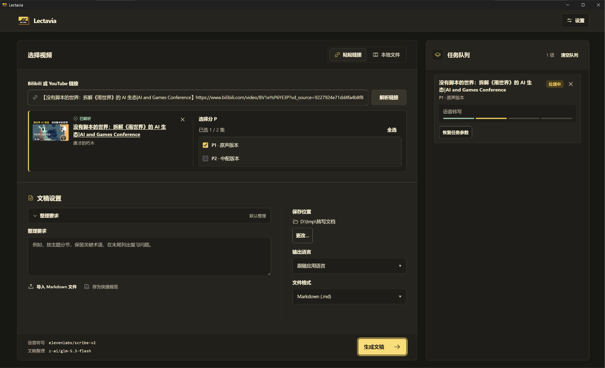

<div align="center">
  

  <h1>Lectavia</h1>

  <p><strong>English</strong> · <a href="README-cn.md">简体中文</a> · <a href="README-jp.md">日本語</a></p>

  <p><strong>Turn long videos into readable documents you can keep</strong></p>

  <p>
    Paste a Bilibili or YouTube link, or drop a local video into Lectavia. It extracts the audio, transcribes it,<br />
    and uses a large language model to correct transcription errors and organize it into a local <code>.md</code> or <code>.txt</code> study document.
  </p>

  <p>
    
    
    
    
  </p>
</div>

<br />

<div align="center">
  
</div>

---

## Why Lectavia?

Video is a good way to share information, but it takes time to skim, search, or revisit. Watching an hour-long lecture, technical talk, or interview at higher speed still takes time if you're taking notes by hand. Raw transcripts can also be hard to read when they contain filler words, awkward sentence breaks, and misrecognized terms.

Lectavia turns a video into a document in three stages.

1. **Extract and split the audio.** Lectavia retrieves the audio from an online video or extracts it from a local video, then splits it into chunks for automatic speech recognition (ASR).
2. **Use the video context to edit the transcript.** A large language model (LLM) receives the full transcript along with the video title, part titles, and description. It uses that context to correct technical terms and transcription errors, organize spoken ideas, and format the document according to your instructions.
3. **Save the document locally.** Lectavia writes a `.md` or `.txt` file that you can open directly in your editor of choice.

---

## Features

### 🎬 Online and local videos, with batch processing for Bilibili parts

- **Supported sources.** Use Bilibili links (including `b23.tv` short links), YouTube links, or local video files (`MP4`, `MKV`, `WebM`, `MOV`, `M4V`, and `AVI`).
- **Choose which parts to process.** After you paste a Bilibili link and leave the input field, Lectavia loads the title and part list. Select any parts to add them to the queue together. Lectavia saves the documents in a folder named after the video.

### ✍️ Shape the document to fit your needs

- **Built-in editing instructions.** Lectavia cleans up speech fragments and transcription errors while preserving the speaker's meaning and key details. The built-in instructions keep editorial markers such as “needs review” out of the document.
- **Custom instructions and presets.** Ask for sections organized by topic with key terms, or lecture notes with review questions. Enter your instructions, import them from a `.md` file, or save them as an **instruction preset** for reuse.
- **Output in 15 languages.** Generate a document in Simplified Chinese, Traditional Chinese, English, Japanese, Korean, French, German, or another supported language, regardless of the video's language.

### 🔑 Bring your own API keys (BYOK)

- **Bundled media tools.** The installers for Windows x64, Linux x64, and Apple Silicon (macOS 26 or later) include `yt-dlp`, `FFmpeg`, `FFprobe`, `Python`, and `QuickJS-NG`. You can process online videos after installation without setting environment variables or installing command-line dependencies.
- **Separate models for transcription and document organization.** Use an OpenAI-compatible provider such as OpenRouter, OpenAI, DeepSeek, SiliconFlow, or a local gateway. Configure speech transcription (`/audio/transcriptions`) and document organization (`/chat/completions`) separately. Lectavia can fetch available models and configure reasoning effort for reasoning models.
- **Local storage.** Lectavia stores API keys in the operating system's credential store and writes generated documents to the local folder you choose. Lectavia has no app accounts or cloud sync.

### 🤖 One task engine for desktop, MCP, and CLI

- **Desktop workspace.** Manage the task queue, cancel individual parts, retry failed tasks, and locate generated documents in your file manager.
- **Built-in MCP service.** Enable HTTP or stdio in Settings so an AI agent in Claude Desktop, Claude Code, Cursor, or another MCP client can inspect videos, read transcripts, and generate summaries.
- **Standalone `lectavia-cli`.** Use the saved model credentials to batch-convert videos into documents from a script without opening the desktop window.

---

## Get started

1. **Configure your models.** Open **Model settings** and enter the full API URL, API key, and model ID for both transcription and document organization. For OpenRouter, use `https://openrouter.ai/api/v1/audio/transcriptions` and `https://openrouter.ai/api/v1/chat/completions`. To load available models, enter the full model list URL in the optional field. The default transcription preset is OpenRouter's `openai/whisper-large-v3-turbo`.
2. **Load a video.** Paste a Bilibili or YouTube link to load its title and any available parts, or select a local video file.
3. **Generate a document.** Choose a local folder and an output format (`.md` or `.txt`). Optionally apply an instruction preset or enter additional instructions. Click **Generate document** to follow progress and open the generated files from the queue on the right.

> **Tip.** If an audio chunk exceeds the 25 MB limit when processing a long video, shorten the default of 1200 seconds (20 minutes) under **Settings → Transcription audio chunk length**, then retry.

---

## Connect an AI agent over MCP

Open **Settings → MCP service** in Lectavia and enable **HTTP** or **stdio**. You can configure HTTP to start with Lectavia. Use **Copy configuration** to copy the configuration for your chosen transport, then paste it into your agent client. Tasks submitted from the desktop and MCP share the same task list and concurrency limit.

| Tool | Purpose |
| :--- | :--- |
| `inspect_video` | Read metadata for a local or online video, including the title and any Bilibili parts. |
| `generate_document` | Submit an asynchronous generation task and return its `job_id`. Supply `video` with optional Bilibili parts, or supply existing `transcript_paths`. Use `mode: "document"` for an LLM-edited document or `mode: "transcript"` for a raw speech transcript. |
| `get_job` | Retrieve the overall status, progress by stage for each part, errors, and the absolute local `output_path` of each generated document. |
| `cancel_job` | Cancel an entire task or selected `part_ids`. Completed files are kept. |

---

## Command-line usage (`lectavia-cli`)

Save your model settings in the desktop app, then run `lectavia-cli` under the same operating system account. The desktop app can be closed.

- **Windows** — `lectavia-cli.exe` in the Lectavia installation directory
- **macOS** — `/Applications/Lectavia.app/Contents/MacOS/lectavia-cli`
- **Linux (`.deb`)** — `/usr/bin/lectavia-cli`

### Examples

```powershell
# Transcribe a local video with custom editing instructions and an output directory.
lectavia-cli "./lesson.mp4" -o "D:/Notes" --instructions "Group the content by topic, keep key terms, and end with review questions."

# Process parts 1 and 3 of a Bilibili video and save them as plain text.
lectavia-cli "https://www.bilibili.com/video/BV1xx411c7mD" --parts "1,3" --format txt

# Process a YouTube video using instructions from Markdown and set the language to English.
lectavia-cli "https://www.youtube.com/watch?v=dQw4w9WgXcQ" --instructions-file "./prompt.md" --lang en
```

### Options

Syntax is `lectavia-cli [options] <video-path-or-url>`.

| Option | Description |
| :--- | :--- |
| `<video-path-or-url>` | Required. A local video path or an HTTPS link to Bilibili (including short links) or YouTube. |
| `-o, --output-dir <directory>` | An existing, writable output directory. Defaults to the current working directory. For multipart videos, Lectavia creates a subdirectory named after the video. |
| `--format <md\|txt>` | Output format. Defaults to `md`. |
| `--parts <numbers>` | Bilibili only. Comma-separated part numbers such as `"1,3"`. If omitted, Lectavia uses the link's `?p=` value or defaults to part 1. |
| `--instructions <text>` | Additional editing instructions. |
| `--instructions-file <file>` | Read editing instructions from a UTF-8 file. Mutually exclusive with `--instructions`. |
| `--lang <zh-CN\|ja\|en>` | Language for built-in prompts, file labels, and terminal progress. Defaults to `zh-CN`. |

The CLI prints one generated document path per line to `stdout` and prints progress and errors to `stderr`, so shell and PowerShell pipelines can capture the output paths. The exit code is `0` when all parts succeed, `1` when the run fails or any part fails, and `2` for invalid arguments.

---

## Local development and builds

<details>
<summary>Development setup and packaging</summary>

### Prerequisites

- Node.js 24, pnpm, Rust stable, and the [Tauri 2 system dependencies](https://v2.tauri.app/start/prerequisites/). On Windows, install the Visual Studio C++ desktop development tools and WebView2.
- For local development, install `FFmpeg` and `yt-dlp`. Processing YouTube also requires `Deno` or `Node.js 22+`. Make the media tools available through `PATH` or `LECTAVIA_MEDIA_DIR`. On Windows, you can use the setup script below to install them.

### Start the development environment

```powershell
pnpm install

# Optional on Windows. Install media tools for local development with WinGet.
powershell -ExecutionPolicy Bypass -File scripts/setup-media.ps1

# Start the desktop app in development mode with hot reload.
pnpm tauri dev
```

### Checks and packaging

```bash
# Check and fix code formatting.
pnpm format:check
pnpm format

# Type-check and build the frontend, then test the Rust backend.
pnpm build
cargo test --manifest-path src-tauri/Cargo.toml --locked

# Build the standalone CLI binary.
cargo build --manifest-path src-tauri/Cargo.toml --release --locked --no-default-features --bin lectavia-cli

# Build platform installers with bundled media tools.
npm run app:build:setup                     # Windows x64 (NSIS)
pnpm tauri build --bundles deb,appimage     # Linux x64
pnpm tauri build --bundles dmg              # Apple Silicon (macOS 26 or later)
```

Packaging downloads and verifies prebuilt LGPL builds of `FFmpeg` and `FFprobe`, along with `Python`, `yt-dlp`, and `QuickJS-NG`. The versions and checksums are maintained in `scripts/prepare-ffmpeg.js` and `scripts/prepare-online-media.*`.

</details>

---

## License

Lectavia is available under the [MIT License](LICENSE). License notices for the bundled third-party media components are in `media-tools/ffmpeg/dist` under the application directory.
